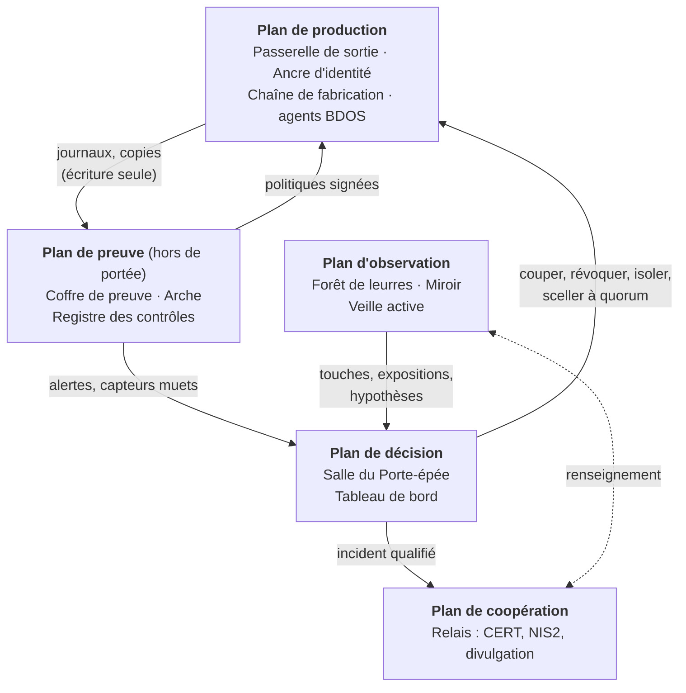
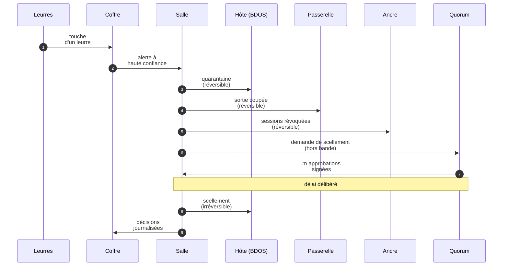

# Une architecture d'applications pour le domaine noir

## Comment mettre en œuvre les treize principes à l'échelle d'une organisation

> L'essai [« Le domaine noir et la cyberdéfense »](domaine-noir-cyberdefense.md) dégage treize principes, une grille de lecture et un ordre de mise en œuvre. Ce document en tire une architecture : onze applications réparties sur cinq plans, huit règles qui les tiennent ensemble, quatre flux qui les font travailler, une feuille de route et un premier squelette de code dans BDOS. Il ne décrit pas un produit à acheter ; il dit quelles fonctions doivent exister, où elles doivent vivre, qui peut les lever et ce qui prouve qu'elles tiennent.

---

## 1. Objet et périmètre

### 1.1 De l'essai à l'architecture

L'essai répond à la question « que faut-il retenir du domaine noir ? ». Ce document répond à la suivante : « quelles applications faut-il faire tourner, et où, pour que ces principes ne restent pas des intentions ? ». Un principe qui n'a ni application pour le porter, ni propriétaire pour en répondre, ni indicateur pour dire qu'il fonctionne finit dans une politique de sécurité que personne ne relit.

Le passage de l'un à l'autre suit trois règles de méthode.

- **Une application par fonction, pas par principe.** Les principes se recoupent : la sortie interdite par défaut sert 3.1 (ce qui sort), 3.3 (les émissions involontaires) et 3.7 (couper en un seul geste). Une architecture qui créerait une application par principe dupliquerait les mêmes points d'application. On part donc des fonctions et l'on vérifie ensuite, par une matrice (section 7), que chaque principe est porté.
- **Assembler avant de construire.** Presque toutes les fonctions existent sous forme de produits, de logiciels libres ou de services managés : mandataires, résolveurs filtrants, stockages inaltérables, fournisseurs d'identité, outils de leurre, plateformes de partage. Ce qui manque presque toujours, c'est la colle : le modèle de données qui relie un contrôle à sa raison d'être, la logique qui sépare le réversible de l'irréversible, les indicateurs. C'est là que porte le code spécifique, et c'est là que porte le squelette livré avec ce document.
- **L'architecture est elle-même dans la forêt.** Les outils de sécurité sont des cibles de choix : ils voient tout, administrent tout et sortent souvent vers leurs éditeurs. Chaque application décrite ici a donc sa propre zone de confiance, son propre « qui peut la lever » et son propre mode d'échec, et la section 6 traite le modèle de menace de l'ensemble.

### 1.2 Place de BDOS

BDOS, dans ce dépôt, est un agent d'hôte : il s'installe sur un serveur Linux, filtre la sortie des enclaves, ralentit les cadences machine, exige des jetons signés pour les actions privilégiées, pose des leurres et contient à vitesse machine. Dans l'architecture qui suit, il est le **point d'application local** de plusieurs applications : il applique la politique de la Passerelle de sortie au plus près de la charge, alimente le Coffre de preuve avec son journal chaîné, vérifie les capacités émises par l'Ancre d'identité, pose les leurres de la Forêt et exécute les isolements décidés par la Salle du Porte-épée. Les limites que son README documente (clé de signature unique, état de rejeu propre à chaque processus, scellement irréversible déclenché par une seule commande) sont précisément celles que l'architecture traite à l'étage supérieur ; la section 9 montre comment le squelette commence à le faire.

### 1.3 Ce que ce document n'est pas

Ce n'est ni un cahier des charges, ni une liste de produits, ni une architecture de référence pour un secteur réglementé particulier. Les briques citées sont des exemples éprouvés, pas des recommandations d'achat. Les dimensions (nombre d'approbateurs, délais, durées de rétention) sont des points de départ à ajuster à l'hypothèse de menace que chaque organisation aura écrite, ce qui est d'ailleurs la première exigence du principe 3.9.

---

## 2. Huit règles d'architecture

Les applications changent, se remplacent et se rachètent. Les règles qui suivent doivent rester vraies quelle que soit la brique retenue : ce sont les « constantes » de l'architecture, au sens où le domaine noir abaisse une constante plutôt que d'édicter une règle.

**R1. La preuve, la récupération et la décision ne partagent ni l'ancre d'identité ni le plan d'administration de la production.** Le Coffre de preuve, l'Arche et la Salle du Porte-épée vivent dans des comptes, des locataires ou des domaines d'administration distincts, avec leurs propres identités, leurs propres facteurs d'authentification et, si possible, un fournisseur différent. Les flux de la production vers ces plans sont en écriture seule : la production peut déposer, jamais relire, modifier ni effacer. C'est la traduction directe des principes 3.2 (une preuve qu'un administrateur compromis ne peut pas défaire), 3.7 (coordonner hors de portée de l'instrument suspect) et 3.11 (une copie qui ne partage rien avec ce qu'elle sauvegarde).

**R2. Chaque contrôle déclare qui peut le lever.** Un contrôle qu'un administrateur de production compromis peut lever est une règle ; un contrôle qu'il ne peut pas lever, et dont un tiers peut constater qu'il tient, est une loi. La distinction n'est pas honorifique : elle est enregistrée dans le Registre des contrôles et vérifiée par lui. La plupart des contrôles sont, et doivent rester, des règles ; l'essentiel est de ne pas se raconter qu'une règle est une loi (3.2).

**R3. Le réversible s'automatise, l'irréversible se fractionne.** Isoler un hôte, révoquer une session, couper un flux sortant, mettre un compte en quarantaine : ces gestes se défont, ils doivent donc pouvoir partir à vitesse machine, sans attendre la preuve, sous une autorité pré-déléguée par écrit. Sceller une enclave, détruire des données, restaurer en écrasant, révoquer une autorité de certification : ces gestes ne se défont pas, ils exigent plusieurs personnes et un délai délibéré. C'est la leçon du Porte-épée (3.8) : la volonté d'agir est une propriété du système, pas du caractère de celui qui tient l'épée.

**R4. Le silence d'un capteur est un signal.** Toute source de télémétrie émet un battement de cœur ; son absence est une alerte de même rang qu'une détection. Les capteurs sont hétérogènes (réseau, hôte, identité, application) et leurs données quittent l'hôte observé dès qu'elles sont produites. Sous les intellectrons (3.7), on suspecte l'instrument avant de conclure que la physique est calme.

**R5. L'outillage de sécurité sort aussi par la passerelle.** Les agents de détection, les collecteurs et les consoles de sécurité parlent à leurs éditeurs ; ces flux sont des émissions comme les autres (3.3), et un outil de sécurité compromis est un canal de sortie idéal. Ils passent par la Passerelle de sortie, avec des destinations déclarées et journalisées, sans exception de principe.

**R6. L'irréversible est réservé aux joyaux.** Les enclaves scellées, les diodes et les stockages en mode conformité protègent ce qui ne doit jamais sortir ni être effacé. Tout le reste reste réversible, mis à jour, corrigé et surveillé. Un système qui ne reçoit plus ni correctifs ni renseignement n'est pas sûr, il est figé : c'est le tombeau bien éclairé de l'essai (5.2, posture « s'enfermer »).

**R7. L'outillage de sécurité est la nouvelle ancre.** La chaîne de suspicion se déplace sans s'abolir (3.12) : en concentrant les preuves, les clés et les décisions dans quelques applications, l'architecture crée de nouvelles cibles. Chacune a donc son modèle de menace écrit, son propre quorum pour les opérations qui la désarment, et un indicateur vérifiable par un tiers.

**R8. On ne masse pas la flotte.** Pas de fournisseur unique pour la production et sa sauvegarde, pour la détection et sa supervision, pour la messagerie courante et le canal de crise. Un canal hors bande (téléphonie, messagerie indépendante, annuaire papier des astreintes) existe et s'exerce. Une architecture homogène se défend bien contre l'attaque qu'elle attend et tombe d'un bloc devant celle qu'elle n'attend pas (3.9, 3.11).

---

## 3. Vue d'ensemble : cinq plans

Les onze applications se répartissent sur cinq plans. La séparation n'est pas seulement logique : chaque plan a son propre domaine d'administration et ses propres identités (R1), et les flux entre plans sont orientés.



**Le plan de production** est celui où l'adversaire est supposé présent. Il porte les points d'application : la Passerelle de sortie, l'Ancre d'identité de production, la Chaîne de fabrication qui décide de ce qui a le droit de s'exécuter, et les agents d'hôte (BDOS ou équivalents).

**Le plan de preuve** est hors de portée de la production : on y dépose, on n'y relit pas depuis la production. Il garde ce qui doit survivre à une compromission totale : la trace (Coffre de preuve), la capacité de repartir (Arche) et la mémoire des raisons (Registre des contrôles).

**Le plan de décision** est celui où l'on tranche. La Salle du Porte-épée reçoit les signaux, exécute le réversible, prépare et fait approuver l'irréversible. Le Tableau de bord rend visible l'état de la grille de l'essai.

**Le plan d'observation** regarde ce que l'adversaire regarde : l'extérieur (Miroir), les pièges posés à l'intérieur (Forêt de leurres) et les hypothèses que l'absence d'alerte ne suffit pas à réfuter (Veille active).

**Le plan de coopération** est celui que l'univers de Liu Cixin n'a pas : notifier, partager, divulguer, et publier des preuves vérifiables de l'extérieur.

---

## 4. Les onze applications

Chaque fiche suit le même plan : rôle, principes servis, ce qui entre et ce qui sort, zone de confiance et « qui peut la lever », briques existantes, indicateur, apport de BDOS, mode d'échec à surveiller.

### 4.1 Passerelle de sortie et DNS protecteur

**Rôle.** Faire de la sortie l'exception déclarée. Tout flux sortant d'un serveur, d'un système industriel ou d'un poste d'administration passe par un mandataire explicite qui l'autorise par destination et par identité de service, ou il ne passe pas. Le résolveur DNS est imposé, les résolutions directes et le DNS chiffré non maîtrisé sont bloqués, les domaines malveillants sont résolus vers un puits interne dont chaque requête vaut alerte.

**Principes.** 3.1 (ce qui sort), 3.3 (les émissions involontaires deviennent visibles), 3.7 (un point unique où couper), 3.13 (ne pas servir de rebond aux autres).

**Entrées et sorties.** Entrées : la politique de sortie, signée et publiée par le Registre ; les ordres de coupure de la Salle. Sorties : un journal de chaque flux (source, identité, destination, volume) vers le Coffre de preuve.

**Zone de confiance et levée.** Plan de production. C'est une règle, pas une loi : l'équipe réseau peut ouvrir un flux ; elle le fait par un changement de politique enregistré au Registre, avec une date d'expiration pour toute ouverture temporaire. Les ouvertures permanentes vers « tout Internet sur 443 » sont refusées par le validateur de politique.

**Briques existantes.** Mandataires explicites (Squid, Envoy), politiques de sortie des orchestrateurs (NetworkPolicy, Cilium), points de terminaison privés des fournisseurs de nuage, résolveurs avec zones de politique (Unbound ou BIND avec RPZ) ; références : ANSSI PA-022 et PA-066, NSA/CISA *Selecting a Protective DNS Service* (2021), IEC 62443-3-2 pour les zones et conduits industriels.

**Indicateur.** Part des flux sortants qui passent par le mandataire ; nombre de destinations distinctes par hôte et par jour ; résultat du test de démarrage à froid (un hôte neuf peut-il joindre une adresse arbitraire sur le port 443 ?).

**Apport de BDOS.** Le compilateur `bdos/blackdomain/compiler.py` traduit les enclaves en règles `nftables` sur l'hôte : la Passerelle décide au centre, BDOS applique au plus près de la charge, et l'un couvre la panne de l'autre.

**Mode d'échec.** La liste d'autorisation par domaine sans identité de service, qui laisse sortir n'importe quel processus vers un dépôt de code ou un CDN autorisé (MITRE ATT&CK T1102). Et la passerelle unique sans redondance, qui devient le point de coupure de l'attaquant autant que celui du défenseur.

### 4.2 Registre des contrôles (« la Loi »)

**Rôle.** Tenir, sous forme de données et non de documents, la liste des contrôles de l'organisation avec leurs raisons : de quelle attaque chacun est la cicatrice, contre quelle arme il a été conçu, s'il tient par propriété ou par détection, qui peut le lever, s'il se défait, comment un tiers vérifie qu'il tient, qui en répond, quand on le revoit, et quelles exceptions datées le suspendent. Le Registre publie ensuite les politiques signées que les points d'application appliquent.

**Principes.** 3.2 (loi ou règle, preuve ou promesse), 3.8 (aucun contrôle irréversible dans une seule main), 3.9 (l'hypothèse de menace écrite), 3.10 (revues et exceptions qui expirent), 3.13 (chaque règle porte sa cicatrice).

**Entrées et sorties.** Entrées : les propositions de changement, revues et approuvées. Sorties : les politiques signées vers la Passerelle, la Chaîne de fabrication et les agents d'hôte ; la couverture et les exceptions actives vers le Tableau de bord.

**Zone de confiance et levée.** Plan de preuve. Le Registre est une cible de premier ordre (le désarmer, c'est désarmer tout le reste) : toute modification d'un contrôle marqué « loi » ou « irréversible » exige un quorum, et chaque version publiée est signée et horodatée dans le Coffre.

**Briques existantes.** Gestion de configuration en dépôt de code avec revue obligatoire, politique en code (OPA/Rego, Kyverno), signature des politiques ; références : NIST SP 800-160 vol. 2 pour la résilience, NIST CSF 2.0 pour la fonction « Govern ».

**Indicateur.** Part des contrôles critiques qui résistent à un administrateur compromis ; principes sans contrôle ; classes d'effet défendues seulement par détection ; nombre et âge des exceptions actives.

**Apport de BDOS.** C'est la première des deux applications dont ce dépôt fournit un squelette : `bdos/registry/` charge un registre TOML, refuse les incohérences et calcule la couverture (section 9).

**Mode d'échec.** Le registre que personne ne tient à jour et qui finit par décrire une organisation qui n'existe plus. D'où la règle « pas de politique publiée sans entrée au Registre » : si le point d'application n'accepte que des politiques signées par le Registre, le Registre ne peut pas mentir longtemps.

### 4.3 Coffre de preuve

**Rôle.** Recevoir la télémétrie dès sa production, la conserver de façon inaltérable dans un compte distinct, en vérifier l'intégrité et signaler les capteurs devenus muets. Le Coffre est l'endroit où l'on reconstruit ce qui s'est passé quand la production ne dit plus la vérité.

**Principes.** 3.2 (une trace qu'un administrateur compromis ne peut pas défaire), 3.7 (télémétrie hors de l'hôte, capteurs hétérogènes, battement de cœur).

**Entrées et sorties.** Entrées : journaux des hôtes, du réseau, de l'identité, des applications, de la Passerelle, de la Salle ; battements de cœur des capteurs. Sorties : alertes et silences vers la Salle ; indicateurs vers le Tableau de bord ; empreintes quotidiennes publiées hors du compte.

**Zone de confiance et levée.** Plan de preuve, en écriture seule depuis la production (R1). La rétention est une loi : stockage en mode conformité, que même l'administrateur du compte ne peut raccourcir. L'empreinte quotidienne de la chaîne est publiée dans un lieu indépendant (un autre fournisseur, un journal de transparence, voire un registre papier signé), si bien qu'un tiers peut vérifier qu'aucune journée n'a été réécrite.

**Briques existantes.** Stockage objet avec verrouillage en mode conformité, collecteurs et formats ouverts (OpenTelemetry, syslog signé), SIEM ; références : ANSSI PA-012 (journalisation), NIST SP 800-92.

**Indicateur.** Jours de rétention effective ; trous de télémétrie détectés et délai de détection d'un capteur muet ; écarts entre empreintes publiées et recalculées (attendus : zéro).

**Apport de BDOS.** Le journal chaîné de `bdos/core/events.py` est le format natif : chaque enregistrement engage l'empreinte du précédent, ce qui rend toute suppression détectable ; le Coffre en est la version à l'échelle de la flotte, avec ancrage externe des empreintes.

**Mode d'échec.** La collecte par un agent qui partage les identifiants de la production, ou qui relit le Coffre pour « enrichir » ses alertes : un seul chemin de lecture depuis la production suffit à rendre la preuve négociable.

### 4.4 Arche

**Rôle.** Garder une copie des fonctions vitales qui puisse quitter le système qu'elle sauvegarde : hors ligne ou poussée à travers une diode vers un site sans retour, sous des identités qui n'existent pas en production, et dont la restauration dans une salle blanche est chronométrée au moins une fois par an.

**Principes.** 3.11 (ne pas masser la flotte, garder un vaisseau qui peut partir), 3.2 (pour la copie immuable), 3.9 (une défense de nature différente de celles qui protègent la production).

**Entrées et sorties.** Entrées : flux de copie poussés depuis la production, jamais tirés par l'Arche avec des identifiants de production. Sorties : rien vers la production en temps normal ; en crise, une restauration dans un environnement propre, décidée à quorum.

**Zone de confiance et levée.** Plan de preuve, domaine d'administration propre, fournisseur différent si possible (R8). La destruction d'une copie et la restauration qui écrase sont irréversibles : quorum obligatoire (R3).

**Briques existantes.** Règle 3-2-1-1-0 (trois copies, deux supports, une hors site, une hors ligne ou immuable, zéro erreur de vérification), bandes ou stockage déconnecté, diodes de données pour les environnements les plus sensibles, environnement de restauration isolé.

**Indicateur.** Durée chronométrée de restauration du cœur, mesurée en exercice et non estimée ; part des fonctions vitales couvertes ; date de la dernière restauration complète réussie.

**Apport de BDOS.** Aucun direct : l'Arche est volontairement d'une autre nature que la production. C'est la meilleure illustration de R8.

**Mode d'échec.** La sauvegarde administrée depuis l'annuaire de production, que l'attaquant supprime avant de chiffrer ; et la copie jamais restaurée, dont on découvre le jour de la crise qu'elle ne contient pas ce qu'on croyait.

### 4.5 Ancre d'identité

**Rôle.** Être l'ancre de confiance des personnes et des charges : authentification multifacteur résistante à l'hameçonnage sur tout accès distant et administratif, secrets et certificats de courte durée, identités de charge émises automatiquement, liaison des jetons au poste, inventaire cryptographique et migration vers l'échange de clés hybride post-quantique pour les flux qui doivent rester confidentiels longtemps. L'Ancre a aussi son plan de compromission : que fait-on le jour où c'est elle qui tombe ?

**Principes.** 3.4 (une émission ne se rappelle pas : des secrets courts périment rétroactivement ce qui a déjà fui), 3.12 (la chaîne de suspicion se déplace vers l'ancre, qu'il faut protéger et surveiller), 3.11 (les niveaux d'administration étanches).

**Entrées et sorties.** Entrées : les politiques d'accès du Registre ; les ordres de révocation de la Salle. Sorties : jetons et certificats courts ; journaux d'authentification vers le Coffre ; capacités signées pour les actions privilégiées.

**Zone de confiance et levée.** Plan de production pour l'ancre courante ; une seconde ancre, minimale et distincte, sert les plans de preuve et de décision (R1), de sorte que la compromission de l'annuaire de production ne donne accès ni au Coffre, ni à l'Arche, ni à la Salle.

**Briques existantes.** FIDO2/WebAuthn, identité de charge (SPIFFE/SPIRE), gestionnaires de secrets à baux courts, modules matériels de sécurité pour les clés racines, surveillance de la transparence des certificats ; références : NIST SP 800-207 (Zero Trust), FIPS 203 à 205 (cryptographie post-quantique), ANSSI PA-022 (administration sécurisée).

**Indicateur.** Part des accès sous authentification résistante à l'hameçonnage ; âge médian et maximal des secrets statiques ; part des flux longs sous échange hybride ; délai de détection d'un jeton utilisé hors procédure.

**Apport de BDOS.** La couche `bdos/safetynotice/` vérifie des capacités Ed25519 limitées à un principal, une classe d'action et une ressource, à usage unique et à durée courte : c'est le prolongement naturel de l'Ancre sur l'hôte. L'Ancre porte ce que BDOS ne fait pas seul : la clé d'émission dans un module matériel à quorum, et un registre de révocation partagé entre instances.

**Mode d'échec.** L'ancre unique pour tout, dont la compromission (vol de la clé de signature des jetons, administrateur de l'annuaire) donne la flotte entière ; et la MFA « partout sauf » les comptes de service et les accès d'urgence, qui sont précisément ceux que l'attaquant cherche.

### 4.6 Salle du Porte-épée

**Rôle.** Décider et exécuter la réponse. La Salle reçoit les signaux (touche d'un leurre, exposition, silence d'un capteur, alerte de détection), les classe dans une matrice réversibilité × rayon d'impact, exécute immédiatement ce qui est réversible sous une autorité pré-déléguée, prépare et fait approuver à quorum ce qui ne l'est pas, et garde une action par défaut si personne ne répond (la « main morte » : un isolement provisoire plutôt que l'attente). Elle bascule les répondants sur un canal hors bande dès que la messagerie courante est suspecte.

**Principes.** 3.8 (la clé ne doit pas être une personne), 3.7 (couper en un seul geste, coordonner hors de portée), 3.11 (une autorité qui peut couper avant la preuve).

**La matrice.**

| | Rayon faible (un hôte, un compte) | Rayon large (un service, un site) | Rayon total (l'organisation, les joyaux) |
|---|---|---|---|
| **Réversible** | automatique, immédiat | automatique, astreinte prévenue | astreinte + un second, en minutes |
| **Irréversible** | deux personnes | quorum, délai délibéré | quorum élargi, délai, direction informée |

**Entrées et sorties.** Entrées : alertes du Coffre, touches de la Forêt, expositions du Miroir, hypothèses de la Veille. Sorties : ordres de coupure vers la Passerelle, de révocation vers l'Ancre, de quarantaine ou de scellement vers les agents d'hôte ; incidents qualifiés vers le Relais ; tout est journalisé au Coffre.

**Zone de confiance et levée.** Plan de décision, avec ses propres identités. Désactiver un automatisme de confinement est lui-même une action à quorum : l'attaquant qui prend la Salle ne doit pas pouvoir la rendre muette d'un geste.

**Briques existantes.** Orchestration de la réponse (SOAR), gestion des astreintes, approbations signées, partage de secret de Shamir pour les clés les plus sensibles (PCI DSS 3.7.6 pour le contrôle à plusieurs) ; références : NIST SP 800-61 r3 pour la réponse à incident, ANSSI PA-022.

**Indicateur.** Degré d'exécution : part des alertes qui aboutissent à l'isolement prévu, et en combien de temps ; rôles à titulaire unique ; couverture des nuits et des week-ends ; délai de bascule hors bande en exercice.

**Apport de BDOS.** Le Sentinel de `bdos/sentinel/` est le réflexe local de la Salle : score d'anomalie, quarantaine à vitesse machine. Le squelette (section 9) ajoute le quorum m-sur-n devant le scellement : quand la politique l'exige, le Sentinel garde la quarantaine automatique (réversible) et ne fait plus que recommander le scellement (irréversible).

**Mode d'échec.** Les deux échecs de la trilogie. Celui de Cheng Xin : la capacité existe, mais personne n'est autorisé, entraîné ou disposé à l'exercer à trois heures du matin, et l'alerte reste une alerte. Celui de l'automate sans cage : un isolement irréversible déclenché par un faux positif, ou par un attaquant qui a compris comment provoquer la défense.

### 4.7 Forêt de leurres

**Rôle.** Poser dans l'environnement des objets qu'aucun usage légitime ne touche (identifiants leurres dans les postes d'administration et les coffres, documents balisés, comptes canaris, services pièges internes) et faire de chaque contact un signal à haute confiance, acheminé vers quelqu'un qui sera réveillé.

**Principes.** 3.6 (le sortilège : mesurer la forêt avec une coordonnée qui n'est pas la sienne), 3.10 (une mesure qui ne dépend pas de la détection de l'arme).

**Entrées et sorties.** Entrées : le plan de déception (où, quoi, pour quelle hypothèse). Sorties : touches vers la Salle, avec un niveau de confiance qui autorise l'isolement réversible immédiat.

**Zone de confiance et levée.** Plan d'observation. La liste des leurres est connue d'une équipe restreinte et conservée hors de la production : un leurre que l'administrateur de production peut lister est un leurre que l'attaquant devenu administrateur peut éviter.

**Briques existantes.** Jetons et identifiants leurres (Canarytokens, OpenCanary), pots de miel internes, comptes d'annuaire jamais utilisés ; références : MITRE Engage pour la planification, MITRE ATT&CK pour choisir où l'adversaire passera.

**Indicateur.** Délai entre la touche et sa prise en compte ; touches internes (nulles hors exercice) ; âge des leurres et part renouvelée dans l'année.

**Apport de BDOS.** `bdos/darkforest/` frappe des jetons canaris et des identifiants leurres, et la moindre touche pèse assez lourd pour déclencher la quarantaine. La Forêt les enregistre centralement, les fait vieillir et achemine les touches.

**Mode d'échec.** Le leurre que personne ne surveille, dont la touche arrive dans une boîte de réception lue le lundi ; et le leurre trop parfait, qui finit par être utilisé par un script légitime et apprend à l'équipe à ignorer ses alertes.

### 4.8 Miroir de l'adversaire

**Rôle.** Voir l'organisation comme la voit un inconnu : inventaire continu de la surface exposée, surveillance des journaux de transparence des certificats, recherche de secrets dans les dépôts et les pastes publics, enregistrements DNS orphelins, empreinte des fournisseurs, corrélation avec le catalogue KEV. La règle de fonctionnement est simple : une exposition non prévue est un incident, avec un propriétaire et un délai, pas une ligne de rapport.

**Principes.** 3.3 (toute émission est une coordonnée, y compris celles des fournisseurs), 3.10 (l'adversaire a progressé pendant que vous ne regardiez pas), 3.13 (les résidus qu'on laisse derrière soi).

**Entrées et sorties.** Entrées : sources publiques, inventaire déclaré, liste des fournisseurs. Sorties : incidents d'exposition vers la Salle ; écarts entre inventaire déclaré et observé vers le Registre et le Tableau de bord.

**Zone de confiance et levée.** Plan d'observation, idéalement opéré depuis l'extérieur du réseau de l'organisation (il doit voir ce que voit un inconnu, pas ce que voit un employé).

**Briques existantes.** Outils de gestion de la surface d'attaque externe, surveillance CT (RFC 6962), détection de secrets, catalogue KEV de la CISA (BOD 22-01) ; références : NIS2 art. 21 et DORA art. 28 pour la cartographie des tiers.

**Indicateur.** Temps avant le premier balayage d'un hôte neuf exposé (mesuré avec un hôte témoin) ; délai médian d'atténuation des KEV sur les actifs exposés ; délai entre l'annonce d'une compromission chez un fournisseur et la fin de la chasse correspondante ; DNS sans cible vivante.

**Apport de BDOS.** Aucun direct ; le Miroir alimente en revanche les politiques que BDOS applique (destinations à couper, services à retirer).

**Mode d'échec.** Le rapport mensuel d'exposition que personne ne traite, et l'inventaire « déclaré » qui sert de référence alors que l'observé le contredit.

### 4.9 Chaîne de fabrication attestée

**Rôle.** Décider de ce qui a le droit de s'exécuter. Les artefacts sont construits sur une chaîne isolée qui produit une provenance signée ; l'admission en production refuse ce qui n'est pas signé ou dont la provenance ne correspond pas. La chaîne fait aussi passer à chaque version un banc d'oracles : tests automatisés qui vérifient que les services répondent de façon indifférenciée (même message, même temps, même code) quelle que soit la justesse de l'hypothèse de l'attaquant.

**Principes.** 3.2 (une admission qui refuse le non signé est une loi pour l'exécution), 3.5 (« Ne répondez pas » : la réponse est l'information), 3.12 (la confiance se déplace vers la chaîne de fabrication, qu'il faut protéger).

**Entrées et sorties.** Entrées : code source, dépendances, politiques d'admission du Registre. Sorties : artefacts signés, provenance, résultats du banc d'oracles ; journaux vers le Coffre.

**Zone de confiance et levée.** Plan de production, mais les clés de signature vivent dans un module matériel hors de portée des administrateurs de la chaîne ; l'exception d'admission (« laisser passer ce conteneur non signé ») est une exception datée au Registre.

**Briques existantes.** SLSA pour les niveaux de provenance, Sigstore/cosign pour la signature, contrôleurs d'admission (Kyverno, OPA Gatekeeper), nomenclatures logicielles (SBOM), détection de secrets avant validation ; références : règlement européen sur la cyberrésilience (CRA) pour les obligations des fabricants.

**Indicateur.** Part des charges en production dont la provenance est vérifiée à l'admission ; exceptions d'admission actives ; résultats du banc d'oracles (oracles connus et acceptés, nouveaux oracles).

**Apport de BDOS.** Les profils `seccomp` et l'interposition de commandes de `os/` complètent l'admission au niveau de l'hôte : ce qui est admis reste borné dans ce qu'il peut faire.

**Mode d'échec.** La chaîne de fabrication elle-même compromise (le cas SolarWinds), qui signe fidèlement un artefact piégé : la signature prouve l'origine, pas l'innocuité. D'où la provenance qui décrit aussi les entrées, et la surveillance des écarts de comportement après admission.

### 4.10 Veille active

**Rôle.** Refuser que l'absence d'alerte vaille absence d'adversaire. La Veille tient un carnet d'hypothèses de chasse (« un attaquant installé utiliserait tel mécanisme de persistance ; le cherchons-nous ? »), conduit des évaluations de compromission aux moments de transition (acquisition, changement de prestataire, départ d'un administrateur), organise les exercices chronométrés et les tests fondés sur la menace.

**Principes.** 3.10 (deux siècles sans défaite ne prouvent rien), 3.9 (tester contre l'arme suivante, pas contre la précédente).

**Entrées et sorties.** Entrées : renseignement sur la menace (Relais), écarts du Miroir, données du Coffre. Sorties : hypothèses testées et leurs résultats ; exercices et leurs chronos vers le Tableau de bord ; incidents vers la Salle quand une hypothèse se confirme.

**Zone de confiance et levée.** Plan d'observation. La Veille lit le Coffre avec ses propres identités, jamais celles de la production.

**Briques existantes.** Méthodes de chasse par hypothèses, MITRE ATT&CK pour couvrir les techniques, tests TIBER-EU et tests fondés sur la menace de DORA (art. 26) pour les entités concernées.

**Indicateur.** Hypothèses de chasse testées par mois ; délai de détection en exercice ; part des transitions accompagnées d'une évaluation de compromission.

**Apport de BDOS.** `python -m bdos simulate` est un exercice miniature : une rafale d'agent autonome rejouée de façon déterministe, avec un résultat attendu. La Veille généralise : chaque contrôle du Registre devrait avoir son exercice.

**Mode d'échec.** La chasse qui ne cherche que ce que les outils savent déjà détecter, et l'exercice dont on connaît la date, le scénario et la fin.

### 4.11 Relais de coopération

**Rôle.** Parler, au bon moment, à ceux qui doivent savoir. Le Relais tient les délais de notification (pour NIS2 : alerte précoce sous 24 heures, notification sous 72 heures, rapport final sous un mois), le partage de renseignement marqué selon le protocole TLP avec les CERT et les pairs du secteur, la réception des signalements de chercheurs (fichier `security.txt`, RFC 9116, politique de divulgation coordonnée), et la publication d'indicateurs que n'importe qui peut vérifier de l'extérieur : enregistrements DMARC, ROA RPKI, filtrage d'usurpation d'adresses (BCP 38).

**Principes.** 3.12 (raccourcir la chaîne de suspicion par des institutions), 3.13 (le milieu commun), et la posture « coopérer » de l'essai (5.2), celle que la trilogie n'offre pas.

**Entrées et sorties.** Entrées : incidents qualifiés par la Salle, signalements extérieurs, renseignement reçu. Sorties : notifications réglementaires, partages TLP, avis de divulgation, indicateurs publiés ; renseignement reçu vers la Veille.

**Zone de confiance et levée.** Plan de coopération, avec un canal qui fonctionne même quand la messagerie de l'organisation est compromise.

**Briques existantes.** Plateformes de partage (MISP), TLP 2.0 du FIRST, CSIRT sectoriels et nationaux ; références : NIS2 art. 23, DORA pour les incidents majeurs liés aux TIC, RGPD art. 33 pour les violations de données personnelles.

**Indicateur.** Délai entre la détection et le premier partage ; respect des délais réglementaires en exercice ; indicateurs vérifiables de l'extérieur en place (DMARC en rejet, ROA publiés).

**Apport de BDOS.** Aucun direct ; le journal chaîné fournit en revanche des éléments qu'un tiers peut vérifier, ce qui rend le partage crédible.

**Mode d'échec.** Le silence envers son propre camp, que l'essai range parmi les choses à refuser : l'organisation qui ne partage pas par peur de se signaler et qui découvre que ses pairs ont subi la même attaque la semaine précédente.

### 4.12 Le tableau de bord transverse

Le Tableau de bord n'est pas une douzième fonction de défense : il rend visibles les indicateurs de la grille 5.1 de l'essai, alimentés par le Coffre, le Registre, la Salle et la Veille. Il porte aussi les indicateurs de soutenabilité que l'essai demande en 5.3 : nombre et âge des exceptions actives, taux de contournement (informatique fantôme), délai d'accès d'un nouvel arrivant, part du budget récurrent. Une architecture qui empêche de travailler se fait contourner, et le contournement ne se voit que si on le mesure.

---

## 5. Quatre flux

### 5.1 Un leurre est touché

Le flux le plus important est aussi le plus simple : il montre R3 au travail.



Les gestes 3 à 5 partent en secondes, sans attendre qu'un humain confirme : ils se défont si la touche était un exercice ou une erreur. Le geste 8 attend plusieurs personnes et un délai, parce qu'il ne se défait pas. Si personne ne répond, l'isolement reste en place : la main morte joue en faveur du réversible.

### 5.2 Une exposition apparaît

Le Miroir détecte un service d'administration exposé sur Internet, ou un actif exposé qui porte une vulnérabilité du catalogue KEV. La règle « exposition = incident » ouvre un incident à la Salle, avec un propriétaire tiré de l'inventaire et un délai. La Salle peut couper l'exposition à la Passerelle (réversible) sans attendre le propriétaire. La Veille ouvre une hypothèse : si l'exposition date de plus de quelques heures, quelqu'un l'a déjà vue, et il faut chercher ce qu'il en a fait. L'écart entre inventaire déclaré et observé remonte au Registre.

### 5.3 L'ancre d'identité tombe

C'est le scénario que la plupart des plans de réponse ne savent pas jouer, parce qu'ils supposent l'annuaire disponible pour organiser la riposte. Ici, la Salle, le Coffre et l'Arche ont leur propre ancre (R1) : les répondants se connectent avec des identités qui n'existent pas en production, sur le canal hors bande. Les décisions irréversibles (reconstruire l'annuaire, révoquer l'autorité de certification interne) passent par le quorum de la Salle. La reconstruction part de l'Arche, dans la salle blanche, et non d'une sauvegarde administrée depuis l'annuaire compromis.

### 5.4 Un incident est qualifié

La Salle qualifie l'incident ; le Relais déclenche les horloges réglementaires et prépare le partage. Les indicateurs techniques partent vers le CERT sectoriel en TLP:AMBER, les éléments de contexte vers les pairs en TLP:GREEN une fois l'incident maîtrisé. Les empreintes publiées du Coffre permettent à un tiers de vérifier que la chronologie communiquée n'a pas été réécrite. Le renseignement reçu en retour alimente la Veille.

---

## 6. Le modèle de menace de l'architecture

Une architecture de sécurité qui concentre les preuves, les clés et les décisions crée de nouvelles cibles. L'ignorer serait répéter l'erreur du Bunker : construire contre l'arme d'hier sans voir que l'abri lui-même est devenu un objectif.

| Cible | Ce que gagne l'attaquant | Défense dans l'architecture |
|---|---|---|
| Salle du Porte-épée | désactiver les automatismes, déclencher un isolement destructeur | identités propres (R1) ; désactivation d'un automatisme à quorum ; scellement à quorum avec délai ; journal au Coffre |
| Registre des contrôles | publier une politique qui ouvre la sortie ou l'admission | quorum sur les lois et l'irréversible ; politiques signées ; versions horodatées au Coffre ; écart observé/déclaré remonté par le Miroir |
| Coffre de preuve | effacer ses traces | écriture seule depuis la production ; rétention en mode conformité ; empreintes publiées hors du compte |
| Forêt de leurres | connaître les leurres pour les éviter | liste hors de la production ; équipe restreinte ; renouvellement |
| Ancre d'identité | toute la flotte | seconde ancre pour les plans hors de portée ; clés racines en module matériel à quorum ; plan de compromission exercé |
| Chaîne de fabrication | signer un artefact piégé | clés hors de portée des administrateurs de la chaîne ; provenance des entrées ; surveillance après admission |
| Éditeur d'un outil de sécurité | canal de sortie et d'exécution privilégié | sortie par la Passerelle (R5) ; hétérogénéité (R8) ; mises à jour admises comme tout artefact |
| Les approbateurs | contraindre ou tromper m personnes | m choisi selon l'erreur redoutée ; approbateurs répartis (lieux, hiérarchies) ; délai délibéré qui laisse le temps de s'opposer |

Le quorum n'est pas une protection contre tout. Si les m approbateurs collaborent, ou sont trompés ensemble par un même faux récit, il signe ce qu'on lui présente. C'est pour cela que la demande décrit l'action exacte (action, cible, motif, demandeur) et que la signature porte sur cette description : on peut tromper des approbateurs sur le contexte, pas sur l'objet de ce qu'ils signent.

---

## 7. Correspondance entre principes et applications

| Principe | Application principale | Applications d'appui | Indicateur de tête (grille 5.1) |
|---|---|---|---|
| 3.1 Ce qui sort | Passerelle de sortie | agents d'hôte, Salle | part des flux sortants via mandataire |
| 3.2 Une loi, une preuve | Registre des contrôles | Coffre, Arche, Chaîne | contrôles critiques résistant à un administrateur compromis |
| 3.3 Toute émission est une coordonnée | Miroir | Passerelle, Ancre (CT) | temps avant premier balayage d'un hôte neuf |
| 3.4 Une émission ne se rappelle pas | Ancre d'identité | Chaîne (secrets) | âge des secrets statiques |
| 3.5 La réponse est l'information | Chaîne de fabrication (banc d'oracles) | Passerelle (abandon silencieux) | résultats des tests d'énumération |
| 3.6 Le sortilège | Forêt de leurres | Salle | délai touche → prise en compte |
| 3.7 Sous les intellectrons | Coffre de preuve | Salle (hors bande), Passerelle | trous de télémétrie détectés |
| 3.8 La clé n'est pas une personne | Salle du Porte-épée | Registre, Ancre (quorum des clés) | degré d'exécution ; rôles à titulaire unique |
| 3.9 Le Bunker | Registre des contrôles | Veille, Arche | classes d'effet sans contrôle par propriété |
| 3.10 Deux siècles sans défaite | Veille active | Miroir, Registre (revues) | délai d'atténuation des KEV ; détection en exercice |
| 3.11 Ne masse pas la flotte | Arche | Ancre (niveaux), Salle | restauration du cœur chronométrée |
| 3.12 La chaîne se déplace | Ancre d'identité | Chaîne, Relais | accès sous MFA résistante à l'hameçonnage |
| 3.13 Le milieu | Relais de coopération | Miroir, Registre (cicatrices) | DNS sans cible vivante ; indicateurs vérifiables de l'extérieur |

Aucun principe ne repose sur une seule application, et aucune application ne porte un seul principe : c'est le signe que le découpage suit des fonctions et non des slogans.

---

## 8. Feuille de route

L'essai le dit en 5.3 : commencer par l'enclave est l'erreur du Bunker. La feuille de route suit donc l'ordre inverse de l'élégance.

**Phase 0. L'hygiène.** Le guide d'hygiène informatique de l'ANSSI (quarante-deux mesures) reste le point de départ : inventaire, mises à jour, comptes nominatifs, sauvegardes, cloisonnement minimal. Sans lui, les applications suivantes protègent un système qu'on ne connaît pas.

**Phase 1. Les quatre socles.** Quatre contrôles servent chacun plusieurs principes et coûtent peu au regard de ce qu'ils périment ; ils appellent une version minimale de cinq applications.

1. Sortie interdite par défaut et DNS protecteur : la Passerelle de sortie, en commençant par les serveurs et les postes d'administration.
2. Journaux et copie des fonctions vitales hors de portée des identités de production, restaurés une fois dans l'année : un Coffre de preuve minimal (un compte distinct, la rétention en mode conformité) et une Arche minimale (une copie hors ligne, une restauration chronométrée).
3. Authentification résistante à l'hameçonnage sur tout accès distant et administratif : l'Ancre d'identité.
4. Autorité d'isolement pré-déléguée par écrit, chronométrée en exercice : une Salle du Porte-épée réduite à une procédure, un bouton d'isolement et un canal hors bande.

Le Relais de coopération existe dès cette phase sous sa forme minimale, parce que la loi l'impose : qui notifie, dans quels délais, par quel canal.

**Phase 2. La mesure.** Le Miroir (inventaire externe continu, CT, KEV), la Forêt de leurres (quelques identifiants leurres bien placés valent mieux qu'un parc de pots de miel), la Veille active (un carnet d'hypothèses, un exercice par trimestre). C'est aussi la phase où le Registre des contrôles devient la source des politiques, et où le Tableau de bord commence à afficher la grille.

**Phase 3. Les contrôles par propriété.** Diodes, modules matériels à quorum, provenance signée et admission stricte, enclaves scellables pour les joyaux, quorum devant l'irréversible dans la Salle. Ce sont les contrôles les plus coûteux et les plus partiels ; ils sont réservés aux fonctions dont on a écrit l'hypothèse de menace au Registre.

À chaque phase, les indicateurs de soutenabilité accompagnent les indicateurs de protection. Une phase qui fait monter le taux de contournement n'est pas terminée.

---

## 9. Le squelette de code

Deux des onze applications ont reçu un premier squelette dans ce dépôt, parce que ce sont celles qui relèvent le moins de l'assemblage de produits existants : la logique du Registre et celle du quorum de la Salle. Les deux s'appuient sur les primitives de BDOS (`bdos/core/crypto.py` pour Ed25519, `bdos/core/events.py` pour le journal chaîné, `bdos/core/config.py` pour le chargement TOML) et ne dépendent que de la bibliothèque standard et de `cryptography`.

### 9.1 Le Registre des contrôles : `bdos/registry/`

Un registre est un fichier TOML de contrôles. L'exemple `os/etc/bdos/controls.toml` en contient treize, un par principe, dont deux portent un défaut volontaire.

```toml
[[control]]
id = "C-3.9-backup-diode"
principle = "3.9"
title = "Copie des fonctions vitales poussée à travers une diode vers un site sans retour"
kind = "loi"
scar = "Sauvegardes supprimées depuis la console d'administration compromise"
threat_hypothesis = "Toute arme capable d'atteindre le plan d'administration, connue ou non"
effect_class = "destruction"
property_based = true
lifted_by = []
resists_compromised_admin = true
third_party_check = "Inspection physique de la diode ; restauration annuelle constatée par l'audit"
reversible = false
indicator = "Durée chronométrée de restauration du cœur"
owner = "plateforme"
review_by = 2027-06-30
```

`bdosctl registry check` applique les règles de l'essai et sort avec le code 3 à la moindre erreur, ce qui permet de l'utiliser comme garde-fou en intégration continue :

- une « loi » qu'un administrateur compromis peut lever, ou qu'aucun tiers ne peut vérifier, est refusée (3.2) ;
- un contrôle sans cicatrice ou sans hypothèse de menace est refusé (3.13, 3.9) ;
- un contrôle irréversible qu'un seul rôle peut lever est refusé, de même qu'une exception sur un tel contrôle approuvée par moins de deux personnes (3.8) ;
- une exception sans date d'expiration ou expirée est refusée, une revue échue est signalée (3.10).

`bdosctl registry coverage` donne la vue d'ensemble : principes sans contrôle, classes d'effet défendues seulement par la reconnaissance de l'arme (le Bunker contre le photoïde), exceptions actives et leur âge.

```
$ bdosctl registry check os/etc/bdos/controls.toml --today 2026-10-20
ERROR   C-3.5-uniform-errors   [3.10] exception 'EX-legacy-portal' expired on 2026-09-30
ERROR   C-3.8-seal-enclave     [3.8] irreversible, yet a single role ('astreinte') can lift it
13 controls, 2 errors, 0 warnings

$ bdosctl registry coverage os/etc/bdos/controls.toml --today 2026-10-20
controls            : 13 (2 laws)
principles uncovered: (none)
detection-only      : exploitation
active exceptions   : 0
```

### 9.2 Le quorum de la Salle : `bdos/quorum/`

Une demande (`ActionRequest`) décrit l'action exacte : action, cible, motif, demandeur, date de création, nonce. Chaque approbateur signe l'empreinte de cette demande avec sa propre clé Ed25519 (`Approval`). La porte (`QuorumGate`) ne laisse passer que si :

- au moins m approbateurs distincts et inscrits ont signé la même demande, avec des signatures valides ;
- la demande est encore dans sa fenêtre de validité ;
- le délai délibéré s'est écoulé depuis la m-ième approbation, c'est-à-dire depuis le moment où le quorum a été atteint ;
- la demande n'a pas déjà été exécutée.

La configuration refuse un quorum d'une seule personne (m < 2), un quorum plus grand que le nombre d'approbateurs inscrits, et deux sièges qui partagent la même clé.

Quand `quorum.seal_requires_quorum` est activé, deux choses changent dans BDOS. `bdosctl seal` exige la demande et les approbations, et journalise le refus ou l'acceptation. Le Sentinel garde la quarantaine automatique, réversible, mais ne fait plus que recommander le scellement, irréversible, avec la mention `requires_quorum`. C'est R3 appliquée à l'échelle d'un hôte.

```
bdosctl keygen --out alice.key                     # chaque approbateur, sur son propre poste
bdosctl quorum request --target crown-jewels --reason "jeton leurre touché sur svc-db" \
        --requested-by soc-1 --out req.json
bdosctl quorum approve --request req.json --approver alice --key alice.key --out alice.json
bdosctl quorum approve --request req.json --approver bob   --key bob.key   --out bob.json
bdosctl seal crown-jewels --config bdos.toml --request req.json \
        --approval alice.json --approval bob.json  # refusé avant le délai, accepté après
```

### 9.3 Ce que le squelette ne fait pas encore

- L'ensemble des demandes exécutées est propre au processus, comme le cache de rejeu des jetons de BDOS : un déploiement à plusieurs instances a besoin d'un stockage partagé, idéalement dans le Coffre.
- Le scellement n'est pas exposé par le socket du démon ; `bdosctl seal` reste une démonstration en mémoire, comme avant.
- Le Registre vérifie la cohérence de ce qu'on déclare, pas la vérité de ce qu'on déclare : il faut le croiser avec l'observé (Miroir, Coffre) pour qu'une « loi » déclarée soit une loi constatée.
- Il n'y a pas encore de publication de politiques signées par le Registre vers les points d'application, ni de veto pendant le délai délibéré. Ce sont les deux prochaines étapes naturelles.

---

## 10. Limites et refus

Cette architecture hérite des limites que l'essai reconnaît à l'analogie, et en ajoute une qui lui est propre : elle est grande. Onze applications, cinq plans et un quorum sont hors de portée d'une petite organisation, qui fera mieux de prendre les quatre socles de la phase 1 sous forme de services managés et de s'arrêter là jusqu'à ce que la mesure dise qu'il faut aller plus loin. Une architecture de sécurité qui consomme ce qu'elle protège a déjà perdu.

Elle refuse aussi ce que l'essai demande de refuser. Elle ne frappe pas : aucune application ne riposte vers l'extérieur, la Salle révèle et confine, elle ne contre-attaque pas. Elle ne fait pas de l'isolement une doctrine : l'irréversible reste réservé aux joyaux, tout le reste se corrige et se met à jour (R6). Elle ne se tait pas envers son propre camp : le Relais est dans la phase 1, pas dans la phase 3. Et elle ne fait pas reposer la décision sur le caractère de celui qui tient l'épée : elle la fait reposer sur une autorisation écrite, des gestes exercés, un quorum et un délai, c'est-à-dire sur la cage de Cheng Xin autour de la capacité de Wade.

---

*Ce document accompagne l'essai [« Le domaine noir et la cyberdéfense »](domaine-noir-cyberdefense.md) et le code de BDOS dans ce dépôt (licence MIT). Octobre 2026.*
